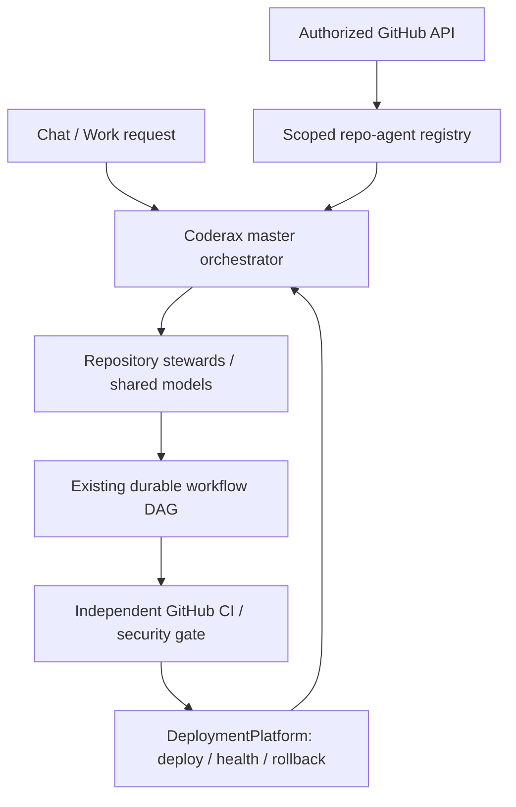

# Portfolio-wide repository agents

**Status:** opt-in backend foundation, not proof of 300 deployed agents. Coderax owns orchestration; DeploymentPlatform remains the deployment executor; GitHub Actions remains an independent security and CI gate. A repository gets an **agent identity**, not a separate model installation. Shared model routing and existing Coderax workflows are reused.

## Safety boundary

The personal registry must contain only explicitly authorized personal/business GitHub owners. `WellsFargo-Engineering-Ops` and repository names with Wells Fargo markers are blocked by code. Other employer-managed resources must also be excluded from the owner allowlist and need separately authorized employer infrastructure. No proprietary code, private employer data, secrets, or tokens flow to personal Coderax.

The registry starts every agent as **read-only and unbound**, with no capability to merge, write, deploy or spend. GitHub token access cannot exceed the actual account permissions. No credentials are saved in the repository or returned to the browser. Existing Coderax access controls still apply to every Agent Management/Workflow call. No automatic model inference starts on discovery.

## 1. Discover authorized repositories without mutating anything

Node.js 22+ is required. Set credentials outside the repository (examples are placeholders; do not commit real tokens):

```sh
export CODERAX_PORTFOLIO_ALLOW_OWNERS='nnabdelshahid,CoderaxAI,Auctivon-*'
export CODERAX_GITHUB_TOKEN='READ_ONLY_GITHUB_TOKEN'
# Optional additional authorized identity:
export CODERAX_GITHUB_TOKEN_SECONDARY='SECOND_READ_ONLY_GITHUB_TOKEN'
node scripts/portfolio/sync.mjs --out ./portfolio-registry.local.json
```

GitHub `/user/repos` discovery pages are deduplicated by case-insensitive `owner/repo`; archived, forked, unreadable, out-of-scope and blocked repositories are excluded. Inventory is generated locally. Never commit `portfolio-registry.local.json`, which can contain private repository names. Store it outside the repo or gitignore it. This produces virtual identities; it **does not** create Coderax agents or access DeploymentPlatform.

## 2. Bind repository stewards to the existing Coderax Agent Management API

Use a Coderax OIDC access token with agent creation permission and an already configured, authorized shared provider/model:

```sh
export CODERAX_API_BASE_URL='https://YOUR-CODERAX-ORIGIN'
export CODERAX_AGENT_ACCESS_TOKEN='SCOPED_OIDC_ACCESS_TOKEN'
export CODERAX_SHARED_MODEL_PROVIDER='YOUR_CONFIGURED_PROVIDER'
export CODERAX_SHARED_MODEL_ID='YOUR_CONFIGURED_MODEL'
node scripts/portfolio/sync.mjs --input ./portfolio-registry.local.json \
  --out ./portfolio-registry.local.json --apply-agents --max-writes 5
```

`--apply-agents` is opt-in. It lists current Agents (paginated), skips matching registered stewards, blocks name collisions, creates at most the specified bounded count, and reads back created IDs. The catalog then records the verified Coderax Agent IDs. Repeat the same command in bounded batches after reviewing status. An API refusal or missing credential must be reported as blocked, not success. Do not assume any model or MCP server is healthy because an agent exists.

## 3. Bind read-only collaboration workflows

Once agent IDs are verified, use Coderax's existing authenticated Workflows API (requires an authorized Coderax session):

```sh
export CODERAX_WORKFLOW_ACCESS_TOKEN='AUTHORIZED_WORKFLOW_SESSION_TOKEN'
node scripts/portfolio/sync.mjs --input ./portfolio-registry.local.json \
  --out ./portfolio-registry.local.json --apply-workflows --max-writes 5
```

Every bound steward can obtain a real Coderax DAG: two independent read-only investigations (`inventory` and `security`, max parallel 2), followed by a dependent `synthesis` step. The workflow is created, **not started automatically**. Existing Coderax permissions, per-step agent scope, cancellation, retries and work state remain authoritative. The script readbacks workflow bindings and refuses collisions. Do not enable large-scale scheduling until pilot model runs are verified.

## Roadmap and release gates

- Local acceptance: `node --test scripts/portfolio/registry.test.mjs` and `node --check scripts/portfolio/sync.mjs`; verify all nine initial tests and Github Actions independently.
- Repair Coderax's prior production lockfile failure (PR #87) before merging/deploying this feature. Do not waive critical security or CI checks.
- Pilot at least three authorized personal/business repositories with real authenticated GitHub, agent discovery, configured model calls, workflow execution, evidence capture, and recovery checks.
- Add signed A2A task/result/status envelopes, secure webhook event dispatch, cross-repository dependency routing, scoped MCP tools, DeploymentPlatform health/deploy adapter with separate approvals, and decentralized swarm coordination before declaring the complete 300-repository system done.
- Process remaining repositories in bounded batches, verify each live agent/workflow in Coderax, and keep failures visible. No bulk secret sharing, paid resources, or automatic privileged GitHub writes.
- Present 5–8 mobile-friendly Portfolio Command Center designs before implementing that UI. Current change is backend-only.

## Logical flow


