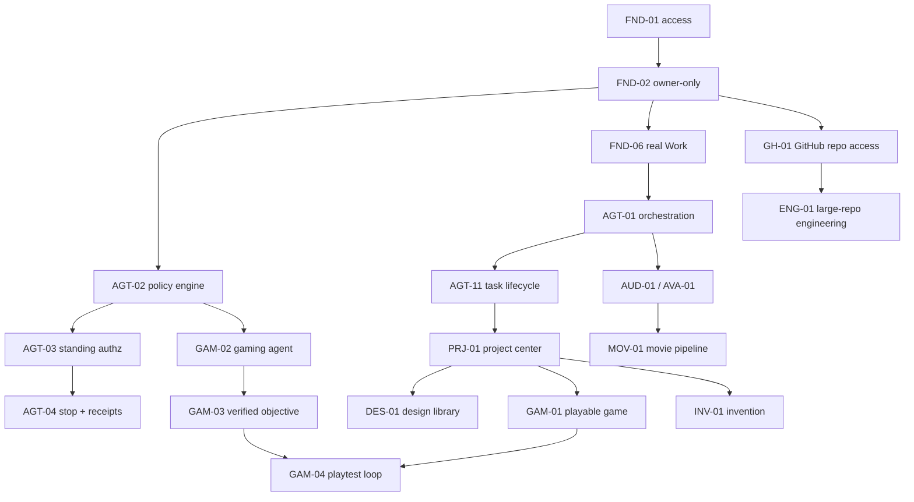

# Coderax master roadmap and capability ledger

**This file is the single durable record of what Coderax is meant to become, what exists, and what
has actually been proven.** It is the answer to the directive's requirement that the roadmap carry
capability identifiers, dependencies, acceptance criteria and verified progress, rather than living
in chat history.

A capability is not complete because a file, a route, a mock or an agent's claim exists. The
`Status` column moves only on retained evidence, and the evidence rules are in
[Status vocabulary](#status-vocabulary) and [Evidence standard](#evidence-standard).

- **Baseline commit:** `386b2b76729f3bc8b51fc2f5c5e34cf5b3e9f7e9` (2026-11-24)
- **How statuses were set:** by reading this tree — module paths, routes, config keys and colocated
  test files. **No test suite, build, or deployment was executed to produce this revision.** Every
  entry that says `Implemented` therefore means _source and colocated specs are present in this
  tree_, not _green at this SHA_.

---

## Operating constraints that bind every entry

These are not aspirations; they are rejection criteria. A change that violates one is not accepted
regardless of the feature it delivers.

| Rule                           | Consequence when violated                                                                                                                          |
| ------------------------------ | -------------------------------------------------------------------------------------------------------------------------------------------------- |
| Zero additional spend          | No paid inference, paid GPU, paid cloud tier, trial credit or automatic upgrade. A provider whose billing plan cannot be verified is not routable. |
| Cloud-only substantive compute | Owner devices are clients. No local WSL, Ollama, Docker or inference for autonomous/workload execution.                                            |
| Owner-only runtime             | No guest access, no public sign-up, no billing or subscription surface.                                                                            |
| Preserve existing data         | Conversations, memories, projects, configs and features survive every migration.                                                                   |
| No fabricated evidence         | Scripts, storyboards, mocks and plans are never reported as playable, deployed or passing.                                                         |
| No arbitrary ceilings          | The registry is open-ended; new capabilities and agents are additions, not rewrites.                                                               |
| UI changes need owner approval | Design work is proposed as compatible specifications. Nothing visual merges unapproved.                                                            |

---

## Status vocabulary

| Status             | Meaning                                                                                            |
| ------------------ | -------------------------------------------------------------------------------------------------- |
| **Planned**        | Specified here with acceptance criteria. No implementation.                                        |
| **In Development** | Partial implementation exists; a named part of the acceptance criteria is unmet.                   |
| **Implemented**    | Source and colocated tests exist in this tree for the full stated scope. Not executed at this SHA. |
| **Tested**         | Acceptance command actually run at a recorded SHA, with exit status and counts retained.           |
| **Live Verified**  | Exercised in a running deployment with real credentials and captured runtime evidence.             |
| **Blocked**        | Cannot proceed; the blocker is named and is not a defect in Coderax.                               |

`Implemented` is deliberately weaker than `Tested`. Moving between them is the routine work of this
ledger.

## Evidence standard

Each row that claims `Tested` or above must be able to name, on request:

1. The exact commit SHA the evidence was produced from.
2. The command and its process exit status.
3. The assertion or test counts, or the captured runtime output.
4. For anything user-visible: the deployment origin and the observation made there.
5. For anything involving an external account: the authorized principal and the permission scope
   actually exercised — never the credential value.

Evidence that cannot supply these stays `Implemented` or lower. Never promote a row because a PR
merged, a preview went READY, or a mock passed.

---

## Verified baseline at this commit

Observed directly in this tree. Paths are relative to the repository root.

| Area                        | Source present                                                              | Notes                                                                                                                        |
| --------------------------- | --------------------------------------------------------------------------- | ---------------------------------------------------------------------------------------------------------------------------- |
| Native agent runtime        | `packages/api/src/agents/`                                                  | Run envelope, execution host, enrollment, subagent threads, delegation                                                       |
| Durable workflows           | `packages/api/src/workflows/`                                               | Engine, store, handlers, schedule and event lanes                                                                            |
| Autonomous build engine     | `packages/api/src/autobuild/`                                               | Plan parse/compile, modes, report, verification, settlement — see [`autonomous-build.md`](autonomous-build.md)               |
| Agent engines               | `packages/api/src/engines/`                                                 | OpenCode, OpenHands, Freebuff adapters behind one contract; arbiter; workspace confinement                                   |
| Zero-cost routing           | `packages/api/src/routing/`, `packages/data-provider/src/free-inference.ts` | Catalog, quota ledger, health/cooldown, probes — see [`free-inference-routing.md`](free-inference-routing.md)                |
| Work lifecycle              | `packages/api/src/work/`                                                    | Admission, readiness, deps, graph, model projection                                                                          |
| Long-term memory            | `packages/api/src/memory/`                                                  | Config, authorization, protection, handlers                                                                                  |
| Projects                    | `packages/api/src/projects/`                                                | Context, resources, turn, resume                                                                                             |
| Schedules                   | `packages/api/src/schedules/`                                               | Recurring cloud jobs with cadence and capacity                                                                               |
| Tool approval / permissions | `packages/api/src/mcp/`, `packages/api/src/acl/`                            | See [`tool-approval-modes.md`](tool-approval-modes.md)                                                                       |
| Visual App Studio           | `packages/api/src/studio/`, `client/src/lib/studio/`                        | Deterministic prompt templates, sandboxed preview, browser-local drafts — see [`visual-app-studio.md`](visual-app-studio.md) |
| Pull request observation    | `packages/api/src/pulls/`                                                   | **Read-only** GitHub PR state and check-run lookup. Not repository access.                                                   |
| Chat + Work shell           | `client/src/routes/`                                                        | `ChatRoute`, `WorkRoute`, `Studio`, `Dashboard`, unified sidebar                                                             |
| Deployment stacks           | `deploy/cloud/`, `deploy/oci/`, `deploy/selfhost/`, `deploy/vercel/`        | Cloudflare/Oracle-adjacent compose stacks exist; `pages.dev` origin unverified                                               |
| Security lab                | `packages/security-lab-core`                                                | Adversarial evaluation harness                                                                                               |

Not present anywhere in this tree: GitHub App or repository read/write access, gaming agent, game
studio, movie pipeline, avatar laboratory, audio studio, 3D/virtual-world studio, CAD/invention lab,
robotics, a 50+ design template catalog, and authenticated external A2A.

---

## Phase 1 — Reliability and engineering foundation

The gate for everything else. No Phase 2+ capability is `Live Verified` while app access, auth or
real Work execution is unproven.

| ID       | Capability                    | Depends on         | Acceptance criteria                                                                                                                                                                                                   | Status                                                                                            |
| -------- | ----------------------------- | ------------------ | --------------------------------------------------------------------------------------------------------------------------------------------------------------------------------------------------------------------- | ------------------------------------------------------------------------------------------------- |
| `FND-01` | Dependable application access | —                  | An authenticated owner loads Chat and Work on a fresh session, reloads mid-conversation, and the transcript and Work state survive. Planned maintenance fixes one root cause per change, not a retry loop.            | In Development                                                                                    |
| `FND-02` | Owner-only runtime            | `FND-01`           | An unauthenticated request to every non-public route is refused. No guest path grants a model run. Asserted by test, not by config intent.                                                                            | In Development                                                                                    |
| `FND-03` | Browser resource budget       | `FND-01`           | `npm run lighthouse` passes its LCP and query budget; an idle tab issues no repeating model or persistence traffic; conversation rendering is virtualized or paginated beyond a bound. Before/after numbers recorded. | In Development                                                                                    |
| `FND-04` | Invokable verification gate   | —                  | `npm run verify` is the acceptance artifact on every PR, pasted into the Testing section, naming commit, base, tree state and each gate's result.                                                                     | In Development                                                                                    |
| `FND-05` | Hosted CI execution           | `FND-04`           | Required checks actually run on the candidate SHA. Until runner startup succeeds, no row may cite CI as evidence.                                                                                                     | Blocked — hosted Actions do not start on this repository; `npm run verify` is the substitute gate |
| `FND-06` | Real Work execution           | `FND-01`, `FND-02` | One Work task on a real free model produces streamed progress, a persisted transcript, a cancellation that settles once, and a reload-safe state.                                                                     | In Development                                                                                    |
| `FND-07` | Single-agent certification    | `FND-06`           | One native agent completes a multi-stage task with retained tool evidence, and the run is reproducible from the recorded SHA.                                                                                         | In Development                                                                                    |
| `FND-08` | Multi-agent certification     | `FND-07`           | All seven capabilities in [`MULTI_AGENT_CERTIFICATION.md`](MULTI_AGENT_CERTIFICATION.md) carry current-SHA evidence, or the row stays uncertified.                                                                    | In Development — ledger records NOT CERTIFIED; A2A and multi-hop unimplemented                    |
| `FND-09` | GitHub repository access      | `FND-02`           | See `GH-01`.                                                                                                                                                                                                          | Planned — sign-in is not repository access                                                        |

## Phase 2 — Native intelligence and autonomy

| ID       | Capability                                       | Depends on | Acceptance criteria                                                                                                                                                                                                                    | Status                                                                                                                                                                                                   |
| -------- | ------------------------------------------------ | ---------- | -------------------------------------------------------------------------------------------------------------------------------------------------------------------------------------------------------------------------------------- | -------------------------------------------------------------------------------------------------------------------------------------------------------------------------------------------------------- |
| `AGT-01` | Native orchestration                             | `FND-06`   | A task is planned, dispatched, retried, cancelled and settled by Coderax's own engine with no third-party agent framework in the path.                                                                                                 | Implemented                                                                                                                                                                                              |
| `AGT-02` | Tool registry and policy engine                  | `AGT-01`   | Tool calls are authorized in backend code before execution; a denial is enforceable independent of the model prompt.                                                                                                                   | Implemented                                                                                                                                                                                              |
| `AGT-03` | Standing authorizations                          | `AGT-02`   | Owner-configured scope (tool, repository, destination, project, time, $0 ceiling) is enforced at execution and survives reload. Expiry and revocation take effect on the next call. In-flight approvals cannot revive a revoked grant. | Tested                                                                                                                                                                                                   |
| `AGT-04` | Emergency stop and action receipts               | `AGT-03`   | One action halts all autonomous work; every authorized action leaves a durable receipt; duplicate submission is refused by identity.                                                                                                   | Planned                                                                                                                                                                                                  |
| `AGT-05` | Zero-cost model routing                          | —          | Only allowlisted, price-verified free endpoints are routable; paid routes are unreachable by construction; exhaustion returns a typed failure instead of a paid fallback.                                                              | Implemented                                                                                                                                                                                              |
| `AGT-06` | Model discovery and health                       | `AGT-05`   | Unknown or unverified endpoints are rejected; repeated failure triggers cooldown; status is exposed without credentials.                                                                                                               | Implemented                                                                                                                                                                                              |
| `AGT-07` | Capability-aware selection                       | `AGT-05`   | Model choice is driven by declared capability (tools, context, reasoning) and current health, not a hardcoded identity.                                                                                                                | In Development — `packages/data-provider/src/model-routing.ts` ranks by tools, context, reasoning, latency, speed and reliability per intent; benchmark comparison is not established                                                    |
| `AGT-08` | Execution profiles                               | `AGT-07`   | Auto, Fast, Complex Reasoning and Agentic profiles resolve to distinct, inspectable routing decisions; Chat defaults to automatic, Work allows explicit override; the active agent and model are always named in the UI.               | In Development — Work exposes `auto`/`fast`/`complex`/`agent` with a named concrete target (`packages/api/src/work/models.ts`), Chat selects automatically and fails closed (`api/server/middleware/buildEndpointOption.js`); the UI does not yet name the executing engine |
| `AGT-09` | Memory architecture                              | `AGT-01`   | The categories in the directive exist as distinguishable stores with search, relevance ranking, provenance, versioning, correction, deletion and access control. Owner can inspect and manage all of it.                               | In Development — memory service exists; category coverage, ranking and versioning not established                                                                                                        |
| `AGT-10` | Outcome-based improvement                        | `AGT-09`   | Verified outcomes and owner feedback change future retrieval and strategy. Documented explicitly as retrieval/strategy refinement, never as model training.                                                                            | Planned                                                                                                                                                                                                  |
| `AGT-11` | Durable task lifecycle                           | `AGT-01`   | Refresh, device change and process restart resume the same task; pause/resume/retry/cancel each settle exactly once.                                                                                                                   | Implemented                                                                                                                                                                                              |
| `AGT-12` | Cloud browser execution                          | `AGT-02`   | Navigation, tabs, forms, upload/download, extraction and session persistence run in cloud infrastructure; steps needing personal verification are distinguished from automated ones.                                                   | In Development — `packages/api/src/web/` present; scope and isolation unverified                                                                                                                         |
| `AGT-13` | Agent engine independence                        | `AGT-01`   | Each engine has separate permissions, credentials, boundaries and activity records; selection is never silent; the UI names the executing engine.                                                                                      | In Development — adapters and registry exist; the UI does not yet name the executing engine and engine credentials are not separated. Live runs unclaimed per [`engine-adapters.md`](engine-adapters.md) |
| `AGT-14` | Workforce roles and teams                        | `AGT-01`   | Owner-defined roles bind to saved agents and models; the supervisor coordinates; a specialist cannot exceed the parent's permissions.                                                                                                  | In Development — delegation exists; role catalog and team composition not established                                                                                                                    |
| `AGT-15` | Independent verification and conflict resolution | `AGT-14`   | A second agent verifies a produced artifact and its disagreement is preserved rather than overwritten by synthesis.                                                                                                                    | Planned                                                                                                                                                                                                  |
| `AGT-16` | Authenticated external A2A                       | `AGT-14`   | Typed request/progress/result envelopes with sender verification, replay rejection, cross-tenant denial and cancellation. In-app callbacks do not satisfy this.                                                                        | Planned — no external protocol endpoint exists                                                                                                                                                           |

`AGT-03` evidence at `9fed8fad`: `cd api && npx jest server/routes/agents/__tests__/authorizations.spec.js --ci`
and `cd packages/api && npx jest src/agents/hitl --ci` exited 0 (4 and 926 passing tests); the
storage and guard suites under `packages/data-schemas` and `packages/data-provider` also exited 0
(7 and 30 passing).

## Phase 3 — Project and design infrastructure

| ID       | Capability                           | Depends on         | Acceptance criteria                                                                                                                                                                                       | Status                                                                                                                           |
| -------- | ------------------------------------ | ------------------ | --------------------------------------------------------------------------------------------------------------------------------------------------------------------------------------------------------- | -------------------------------------------------------------------------------------------------------------------------------- |
| `PRJ-01` | Universal Project Center             | `AGT-11`           | A project carries requirements, milestones, conversation history, agents, assets, source files, version history, previews, test results and exports. Project types are data-driven, not one app per type. | In Development — `projects/` covers context, resources, turn and resume; the registry and studio surfaces are absent             |
| `PRJ-02` | Project type registry                | `PRJ-01`           | Adding a project type requires a registry entry, not a new application. The directive's full category list is expressible.                                                                                | Planned                                                                                                                          |
| `PRJ-03` | Versioned design specification       | `PRJ-01`           | A chosen design is saved as a versioned spec: layout, responsive behavior, tokens, accessibility requirements. Restorable and diffable.                                                                   | Planned                                                                                                                          |
| `DES-01` | Design template library              | `PRJ-03`           | At least 50 templates distinct in layout, typography, color, navigation, density and identity. Superficial duplicates do not count. Search, category, filter, favorites and comparison included.          | Planned — current Studio ships a small deterministic template set                                                                |
| `DES-02` | Template performance isolation       | `DES-01`           | A full gallery of rendered previews stays within the `FND-03` budget: lazy-loaded, isolated, bounded in memory and CPU. Measured, not asserted.                                                           | Planned                                                                                                                          |
| `DES-03` | Visual design studio                 | `DES-01`           | Direct manipulation of a selected component or section without regenerating the project; responsive editing, theme customization, version history, undo/redo.                                             | In Development — MVP is local-first and deterministic; AI-backed generation and multi-file projects are explicitly not built     |
| `DES-04` | Screenshot and sketch to application | `DES-03`           | An uploaded image yields an editable, implementable design spec with recorded provenance.                                                                                                                 | Planned                                                                                                                          |
| `PRJ-04` | End-to-end application generation    | `PRJ-01`, `AGT-07` | A natural-language request produces a repository, a runnable build, tests, and a preview — with the build output retained as evidence.                                                                    | In Development — `autobuild` compiles and verifies plans; the launcher uses a deterministic planner and no checkout provisioning |

## Phase 4 — Gaming and creative vertical slices

Prove one real, narrow vertical slice per studio before widening. A prototype is reported as a
prototype.

| ID       | Capability                                | Depends on                   | Acceptance criteria                                                                                                                                                                                                                                                                                                                                                                                                      | Status                                                                                                                            |
| -------- | ----------------------------------------- | ---------------------------- | ------------------------------------------------------------------------------------------------------------------------------------------------------------------------------------------------------------------------------------------------------------------------------------------------------------------------------------------------------------------------------------------------------------------------ | --------------------------------------------------------------------------------------------------------------------------------- |
| `GH-01`  | GitHub account and repository integration | `FND-02`                     | Owner links a GitHub App or authorized OAuth flow with least-privilege scope; identity verified; explicit repository selection including private repositories and authorized organizations; file and branch read; branch, commit and PR creation; issue and check-run read; revocation and reconnection; granted permissions, last verification time and actionable errors surfaced. Demonstrated from the deployed app. | Planned — this tree has OAuth _sign-in_ (`scope: ['user:email']`) and a read-only PR observer only. Neither is repository access. |
| `GAM-01` | Playable original browser game            | `PRJ-04`                     | One original game with real code, controls, mechanics, a level and a playable build reachable at an isolated preview. Not a website about a game.                                                                                                                                                                                                                                                                        | Planned                                                                                                                           |
| `GAM-02` | Gaming agent perception and control       | `AGT-12`, `AGT-02`           | An agent observes an authorized game through frames or permitted state, interprets HUD/objective/position, and issues bounded keyboard, mouse, controller or official-API actions in a cloud environment.                                                                                                                                                                                                                | Planned                                                                                                                           |
| `GAM-03` | Verified gameplay objective               | `GAM-02`                     | A measurable objective (level complete, puzzle solved) is reached and independently verified from observed state, with the session recording retained. A policy or narration is not evidence.                                                                                                                                                                                                                            | Planned                                                                                                                           |
| `GAM-04` | Autonomous playtest loop                  | `GAM-01`, `GAM-03`           | Gaming agent tests a Coderax-built game, discovers reproducible defects, the engineering agent repairs them, and a regression build is produced — with both reports retained.                                                                                                                                                                                                                                            | Planned                                                                                                                           |
| `GAM-05` | Game Studio lifecycle                     | `GAM-01`, `PRJ-02`           | Design document → engine/architecture choice → assets → mechanics → levels → behavior → controls → build → isolated preview → playtest → repair → regression → delivery, with per-asset modification that does not require rebuilding the game.                                                                                                                                                                          | Planned                                                                                                                           |
| `GAM-06` | Genre expansion                           | `GAM-05`                     | Additional genres (platformer, fighting, FPS, open-world, sandbox, racing, sports, life-sim, RPG, strategy, puzzle, horror, educational) ship as engine capabilities with original or licensed assets only.                                                                                                                                                                                                              | Planned                                                                                                                           |
| `MOV-01` | Movie production pipeline                 | `PRJ-02`, `AVA-01`, `AUD-01` | Story → script → scenes → storyboard → shot generation → edit → sound → grade → **playable video file**. Scripts and stills are never reported as a finished movie.                                                                                                                                                                                                                                                      | Planned                                                                                                                           |
| `MOV-02` | Shot-level regeneration                   | `MOV-01`                     | One shot or scene is regenerated without losing the rest of the production, with character, wardrobe, voice and environment continuity held by persistent reference assets.                                                                                                                                                                                                                                              | Planned                                                                                                                           |
| `AVA-01` | Digital human laboratory                  | `PRJ-02`, `AUD-01`           | An original synthetic character with photoreal face, full body, expressions, gaze, speech, lip sync and persistent personality/memory, reusable across projects. Consent and provenance required for any real likeness or cloned voice; deceptive impersonation refused.                                                                                                                                                 | Planned                                                                                                                           |
| `AUD-01` | Audio studio                              | `PRJ-02`                     | Original music, sound design, voiceover and podcast output as **playable audio files**, with mixing, editing and a timeline, plus licensing and consent records.                                                                                                                                                                                                                                                         | Planned                                                                                                                           |
| `3D-01`  | 3D and virtual world studio               | `PRJ-02`                     | Original models, environments, materials, lighting, cameras and scenes in open formats, reusable in movie, game and avatar projects.                                                                                                                                                                                                                                                                                     | Planned                                                                                                                           |

## Phase 5 — Advanced creative production

| ID       | Capability                       | Depends on         | Acceptance criteria                                                                                                                    | Status  |
| -------- | -------------------------------- | ------------------ | -------------------------------------------------------------------------------------------------------------------------------------- | ------- |
| `MOV-03` | Long-form production             | `MOV-01`           | Multi-scene productions with consistent continuity, assembled into a single deliverable, within verified zero-cost rendering capacity. | Planned |
| `MOV-04` | Distribution artifacts           | `MOV-01`           | Trailer, poster, teaser, thumbnail and interoperable project export generated from the same production state.                          | Planned |
| `AVA-02` | Interactive characters           | `AVA-01`, `AGT-11` | A character holds a conversation with persistent memory, multilingual speech and expression, and can appear in an application or game. | Planned |
| `AVA-03` | Multi-character scenes           | `AVA-02`           | Two or more synthetic characters converse with turn-taking and distinct, retained personalities.                                       | Planned |
| `GAM-07` | World persistence and simulation | `GAM-05`           | Procedural worlds, resource/building/crafting systems and durable state across sessions.                                               | Planned |
| `AUD-02` | Dialogue and localization        | `AUD-01`           | Voiceover, dubbing, subtitles and lip sync across languages from one source script.                                                    | Planned |
| `3D-02`  | XR delivery                      | `3D-01`            | Assets and scenes delivered to an XR-capable runtime where legitimate free capacity allows, otherwise reported as blocked.             | Planned |

## Phase 6 — Personal intelligence and productivity

| ID       | Capability                      | Depends on         | Acceptance criteria                                                                                                                                                                                                                                                                        | Status                                                                                                        |
| -------- | ------------------------------- | ------------------ | ------------------------------------------------------------------------------------------------------------------------------------------------------------------------------------------------------------------------------------------------------------------------------------------ | ------------------------------------------------------------------------------------------------------------- |
| `RES-01` | Research platform               | `AGT-09`           | Multi-source investigation with source discovery, credibility assessment, cross-checking, contradiction detection and citation. Output separates verified, uncertain and unsupported claims.                                                                                               | In Development — `packages/api/src/insights/` and trace surfaces exist; the evidence model is not established |
| `RES-02` | Reusable research library       | `RES-01`           | Findings become durable, searchable project assets usable by later projects.                                                                                                                                                                                                               | Planned                                                                                                       |
| `DOC-01` | Professional document studio    | `PRJ-01`           | Real deliverable files — PDF, Word, spreadsheet, presentation, diagram, specification — produced and editable, not described. Search, translation, extraction, comparison and version history included.                                                                                    | Planned                                                                                                       |
| `CAR-01` | Career assistant                | `AGT-03`           | Job discovery, employer research, truthful tailoring, tracking and duplicate prevention. Never fabricates experience, credentials or submissions; records a receipt per authorized application. Kept separate from existing portfolio repositories and career schedules unless authorized. | Planned                                                                                                       |
| `BIZ-01` | Business studio                 | `RES-01`, `DOC-01` | Market and competitor research, plan, brand, forecast, pitch deck and storefront prototype, with assumptions labelled and estimates distinguished from actuals. No billing, subscription or public launch surface.                                                                         | Planned                                                                                                       |
| `OS-01`  | Personal operating layer        | `AGT-03`, `AGT-11` | Email, calendar, reminders, recurring tasks, briefings and follow-ups as authorized cloud workflows with durable state.                                                                                                                                                                    | Planned                                                                                                       |
| `OS-02`  | Global and project instructions | `AGT-09`           | Standing instructions apply per scope without repetition per conversation, and are inspectable and versioned.                                                                                                                                                                              | In Development — agent-level instructions exist; scoped global policy does not                                |

## Phase 7 — Universal invention and advanced engineering

| ID       | Capability                   | Depends on                  | Acceptance criteria                                                                                                                                                                                                                                     | Status                                                                                                           |
| -------- | ---------------------------- | --------------------------- | ------------------------------------------------------------------------------------------------------------------------------------------------------------------------------------------------------------------------------------------------------- | ---------------------------------------------------------------------------------------------------------------- |
| `INV-01` | Invention pipeline           | `RES-01`, `DOC-01`, `3D-01` | Problem → requirements → literature and prior-art review → concepts → specification → drawing → prototype plan → bill of materials → cost → experiment design → failure-mode analysis. Predictions, simulations and measured results are kept distinct. | Planned                                                                                                          |
| `INV-02` | CAD and analysis             | `INV-01`                    | Parametric mechanical design with structural, thermal and energy analysis whose outputs are labelled as simulation, never as measurement.                                                                                                               | Planned                                                                                                          |
| `INV-03` | Electronics and PCB          | `INV-01`                    | Schematic and board design assistance with component selection and manufacturability notes.                                                                                                                                                             | Planned                                                                                                          |
| `ROB-01` | Robotics and embedded        | `INV-01`                    | Virtual prototype, control software, simulation and implementation documentation for supported boards. Real hardware only with authorized equipment, safe bounds and controls.                                                                          | Planned                                                                                                          |
| `ENG-01` | Large-repository engineering | `FND-09`, `GH-01`           | Repository analysis, architecture and dependency discovery, multi-file change, refactor, migration and modernization on a real imported codebase, delivered as a reviewable PR.                                                                         | Planned                                                                                                          |
| `ENG-02` | Test and CI depth            | `ENG-01`                    | Unit, integration, end-to-end and regression suites generated and executed; CI diagnostics read; load testing bounded to verified resources.                                                                                                            | In Development — the verification runner executes allowlisted gates; e2e and load generation are not established |
| `ENG-03` | Self-repair                  | `ENG-01`, `FND-04`          | A recurring authorized failure is reproduced, repaired on a focused branch, tested, and proposed as a PR with the reproduction retained. The same unresolved error is never merely re-reported.                                                         | Planned                                                                                                          |

## Cross-cutting capabilities

| ID        | Capability                                         | Depends on         | Acceptance criteria                                                                                                                                                                                                                                                    | Status                                                                                    |
| --------- | -------------------------------------------------- | ------------------ | ---------------------------------------------------------------------------------------------------------------------------------------------------------------------------------------------------------------------------------------------------------------------- | ----------------------------------------------------------------------------------------- |
| `SEC-01`  | Owner authentication and session security          | `FND-02`           | Verified owner identity, secure sessions, session revocation, and optionally MFA/passkey. No guest fallback may be introduced to work around an auth defect.                                                                                                           | In Development                                                                            |
| `SEC-02`  | Secret and credential handling                     | `SEC-01`           | Server-side storage only, rotation, scrubbing from outbound text and logs, no secret in a client bundle, repository or transcript.                                                                                                                                     | Implemented — `packages/api/src/cloud/redact.ts` and server-only credential paths         |
| `SEC-03`  | Prompt-injection and tool-abuse resistance         | `AGT-02`           | Injected text cannot change a classification, attach a private resource or widen a tool's authority. Adversarial coverage retained.                                                                                                                                    | In Development — `packages/security-lab-core` exists; coverage is not claimed             |
| `SEC-04`  | Isolation between projects, agents and credentials | `SEC-02`           | Cross-mode, cross-tenant and cross-project access is refused by code, asserted by negative tests.                                                                                                                                                                      | Implemented                                                                               |
| `INT-01`  | Integration registry and connectors                | `AGT-02`           | Scoped authorization, tool discovery, health monitoring, webhooks and revocation per integration. Each verified before enabling.                                                                                                                                       | In Development — MCP exists; the registry and health model are not established            |
| `CLD-01`  | Cloud execution adapter                            | `AGT-11`           | Versioned, authenticated contract for terminal sessions, isolated workspaces, job lifecycle, cancellation, cleanup, artifacts, quotas and health. Each capability verified before it is enabled, never assumed.                                                        | In Development                                                                            |
| `CLD-02`  | Frontend hosting migration                         | `CLD-01`           | Routing, auth callbacks, cookies, CSRF, streaming and build assumptions verified on the replacement origin. Existing data and features preserved.                                                                                                                      | In Development                                                                            |
| `CLD-03`  | Legacy deployment exit                             | `CLD-02`           | Inventory of legacy dependencies, migrated equivalents, and **no** new workload created on the legacy runtime. Cutover only after the replacement is verified and the owner approves. Existing production stays up until then.                                         | In Development                                                                            |
| `PERF-01` | Browser resource discipline                        | `FND-03`           | No re-render storms, duplicated query clients, retry loops, listener or stream leaks, unbounded history rendering or simultaneous previews. Idle means idle. Measured before and after.                                                                                | In Development                                                                            |
| `CLI-01`  | Cross-platform clients                             | `FND-02`, `CLD-01` | Web, desktop, mobile and CLI clients authenticate to the cloud backend, never run inference locally, and share conversation, Work, project and notification state with cancellation and cross-device continuation.                                                     | In Development — `desktop/` is an Electron client; no CLI package or mobile client exists |
| `DOC-02`  | Documentation and release artifacts                | —                  | Versioned, installable artifacts where free distribution permits. No paid developer account or store fee is purchased.                                                                                                                                                 | Planned                                                                                   |
| `REP-01`  | Repository and PR discipline                       | `FND-04`           | Canonical repository identity and authorization verified before modification; focused branches and PRs; default branch never pushed directly; existing PRs repaired rather than duplicated; merge only on satisfied gates; merge and deployed SHA verified afterwards. | Implemented                                                                               |

---

## Dependency spine

Read the spine as _hard_ prerequisites only. Everything else may proceed in parallel when its own
dependencies are satisfied, which is why independent vertical slices are permitted.

---

## Recovery plan for stalled work

Several areas have accumulated claims without evidence. They are worked in this order, one root
cause per change:

1. **`FND-05` CI.** Restore runner execution, or keep `npm run verify` as the sole gate and say so in
   every PR. Do not weaken required checks to obtain a green badge.
2. **`FND-08` multi-agent.** Either produce current-SHA evidence for the seven capabilities or leave
   the ledger uncertified. `A2A` and multi-hop stay `Planned` until an endpoint exists.
3. **`AGT-03` standing authorizations.** This is the highest-value unbuilt Phase 2 item: the directive
   forbids asking the owner to approve routine, already-authorized actions, and forbids bypassing the
   boundary. Per-call approval modes are not a substitute.
4. **`GH-01` GitHub access.** Autonomous engineering is impossible without it. Sign-in is not access.
5. **`PRJ-04` real generation.** Close the gap between the verified plan compiler and an actual
   repository, build and preview.

## How a capability changes state

1. **Planned → In Development** when a branch implements part of the acceptance criteria and the
   unmet remainder is named in this file.
2. **In Development → Implemented** when the full stated scope plus colocated tests exist. Update the
   _Verified baseline_ row and add the module path.
3. **Implemented → Tested** only with a recorded command, SHA, exit status and counts.
4. **Tested → Live Verified** only with a deployment origin and the runtime observation made there.
5. **Any → Blocked** only when the blocker is external and named. A Coderax defect is `In Development`,
   not `Blocked`.
6. **Downgrade honestly.** If later work invalidates evidence, move the row back and say why. A wrong
   `Live Verified` is worse than an unflattering `In Development`.

Adding a capability means adding a row with a new identifier in the right phase; the registry has no
fixed size and no category is capped.

## Relationship to the other documents

| Document                                                       | Relationship                                                                                                                |
| -------------------------------------------------------------- | --------------------------------------------------------------------------------------------------------------------------- |
| [`autonomous-build.md`](autonomous-build.md)                   | Implementation detail behind `PRJ-04` and `ENG-02`. Its "Not implemented" section is authoritative for what it does not do. |
| [`free-inference-routing.md`](free-inference-routing.md)       | Implementation detail behind `AGT-05` and `AGT-06`, including the recorded absence of a verified free full-R1 endpoint.     |
| [`engine-adapters.md`](engine-adapters.md)                     | Implementation detail behind `AGT-13`. Its known limitations govern what may be claimed about live engine runs.             |
| [`MULTI_AGENT_CERTIFICATION.md`](MULTI_AGENT_CERTIFICATION.md) | The evidence ledger for `FND-08`. Its NOT CERTIFIED verdict is binding here.                                                |
| [`tool-approval-modes.md`](tool-approval-modes.md)             | What exists of `AGT-02` and `AGT-03` today.                                                                                 |
| [`visual-app-studio.md`](visual-app-studio.md)                 | The honest scope of `DES-03` today: local-first and deterministic, explicitly not v0.                                       |
| [`PORTFOLIO_ORCHESTRATION.md`](PORTFOLIO_ORCHESTRATION.md)     | Repository steward orchestration; depends on `GH-01` and `FND-08`.                                                          |
| [`CLOUDFLARE_MIGRATION.md`](CLOUDFLARE_MIGRATION.md)           | The canonical-origin cutover, owner handoff, rollback and the exact remaining Cloudflare/OCI actions.                        |
| `AGENTS.md`                                                    | Engineering rules. This file never overrides module boundaries, service-failure contracts or the review policy.             |

## Cloudflare cutover evidence (2026-11-25)

This is a status snapshot, not a completed migration. The canonical Worker is deployed but its API
route is intentionally closed until the owner supplies the backend origin and proxy secret.

| Item | State | Evidence |
| --- | --- | --- |
| Worker host gate and client-IP forwarding | **Tested** | `node --test worker/index.test.mjs` — 17/17 pass at `7c9147e7` plus the working tree. Rejects unknown API hosts with `421`, accepts only the public Coderax `sslip.io` backend form, requires a 32+ character proxy secret, and strips client-supplied `X-Forwarded-For`. |
| Anonymous owner-only gate | **Tested** | `node --test scripts/verify-coderax-access.test.mjs` — 8/8 pass; the live legacy origin returns `401` on every private collection and on Chat, Work and agent inference. Live canonical checks are blocked at the Worker's `503`. |
| Canonical Oracle origin defaults | **Implemented** | `deploy/oci/compose.yaml` defaults `DOMAIN_CLIENT`/`DOMAIN_SERVER` to the Workers origin and sets `ENABLE_GUEST_ACCESS=false`; Caddy's direct-Work host reads `CODERAX_PUBLIC_HOST`. Not deployed; the running VM still reports `serverDomain=https://coderaxai.vercel.app`. |
| Oracle backend reachability | **Partial** | Vercel `/readyz` returns `OK` and upstream responses carry `via: 1.1 Caddy`, so a Caddy-fronted API is running. The actual Oracle public origin is not recorded in this repository; the only `sslip.io` address in the tree is the documentation example `93.184.216.34`. |
| Cloudflare API cutover | **Blocked** | `https://coderax.nnabdelshahid.workers.dev/api/config`, `/health` and `/readyz` return `503 {"error":"API proxy is not configured"}`. `CODERAX_API_ORIGIN` and `CODERAX_PROXY_SECRET` are absent; this workspace's Cloudflare integration returns authentication error `9106`, so the owner or ChatGPT must set them. |
| Authenticated production journey | **Not run** | No owner password or session is available in this workspace. Conversation, project, file, memory, Work and agent behavior remain unverified on the canonical origin. |
| Exact release revision | **Blocked** | The legacy origin reports no full `buildInfo.commit`; the Cloudflare release gate is owned by PR #303 and the exact Workers-origin verifier acceptance by PR #302. |

## Change control

- This file is a ledger, not a promise. Numbers, dates and statuses require evidence.
- UI and visual work is proposed here or in a companion specification and merges only with explicit
  owner approval. The current visual identity is preserved unless the owner authorizes a change.
- No entry may be marked achieved to unblock a release. If a check failed or could not run, that is
  recorded as a limitation.
