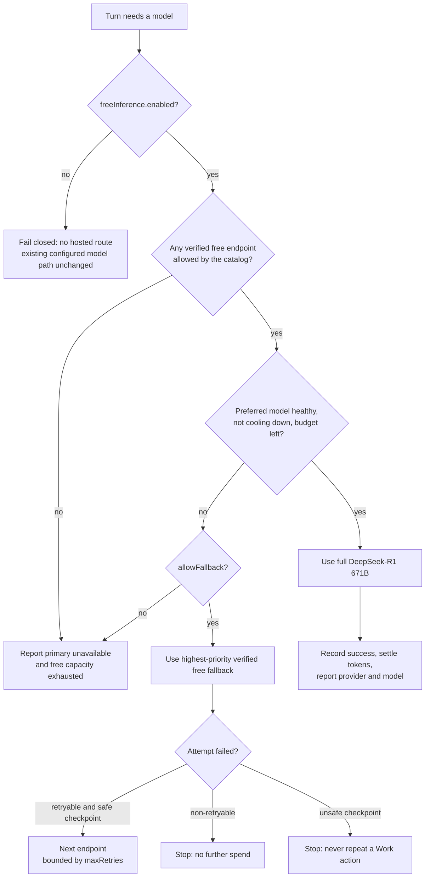

# Zero-cost hybrid inference routing

Native Work can use a server-owned allowlist of OpenRouter models whose
documented price is $0. The preferred model is the full **DeepSeek-R1 671B**. When no
verified free endpoint serves it, the router says so and uses the best verified
free fallback instead. There is no paid route in the code, and none can be
configured into existence.

## What is implemented

| Piece                 | Location                                                                 | Behavior                                                                                                                  |
| --------------------- | ------------------------------------------------------------------------ | ------------------------------------------------------------------------------------------------------------------------- |
| Free endpoint catalog | `packages/data-provider/src/free-inference.ts`                           | Allowlisted providers, exact model ids, pricing evidence, capability flags                                                |
| Model identity guard  | same                                                                     | Accepts only the full R1 checkpoint; every `distill`, `lite`, Qwen or Llama derivative is rejected as the preferred model |
| Zero-cost enforcement | same                                                                     | Rejects unknown providers, unverified pricing, trial credits and any non-zero rate                                        |
| Router                | `packages/api/src/routing/router.ts`                                     | Orders primary then fallbacks, reserves budget before each attempt, records health, bounds retries to `maxRetries + 1`    |
| Quota ledger          | `packages/api/src/routing/quota.ts`, `budget.ts`                         | Per-endpoint daily request and token budgets with reservations and settlement                                             |
| Cooldowns             | `packages/api/src/routing/health.ts`                                     | An endpoint that fails `failureThreshold` times is skipped until its cooldown expires                                     |
| Safe checkpoints      | `packages/api/src/routing/checkpoint.ts`                                 | A model switch is allowed only at `turn_start` or `between_tool_calls`                                                    |
| Live probe            | `packages/api/src/routing/probe.ts`, `scripts/verify-free-inference.mjs` | One authenticated inference request validates credential, model id and response shape                                     |
| Transport budget      | `packages/api/src/endpoints/openai/freeOpenRouter.ts`                    | Each native free completion debits the deployment ledger before the provider call; exhaustion fails closed                |
| Status endpoint       | `GET /api/work/routing`                                                  | Active provider and model, primary availability and reason, per-endpoint quota; no credentials or provider payloads       |
| Composer badge        | `client/src/components/Chat/Input/WorkRoutingBadge.tsx`                  | Names the active provider and model, and the preferred model's absence; renders nothing while routing is disabled         |
| Config                | `freeInference` in `coderax.yaml`                                        | Disabled by default; budgets, retries, cooldown and timeouts are operator levers                                          |

## Routing planner order



## Configuration

```yaml
freeInference:
  enabled: false # opt in; nothing hosted is called while false
  allowFallback: true
  maxRequestsPerDay: 200
  maxTokensPerDay: 400000
  openRouterMaxOutputTokens: 4096 # per native FreeOpenRouter completion
  maxRetries: 2 # at most three calls per turn
  failureThreshold: 2
  cooldownMs: 60000
  requestTimeoutMs: 60000
```

`maxRequestsPerDay` and `maxTokensPerDay` are enforced twice against one shared
ledger: the routing planner reserves before an attempt, and the native
FreeOpenRouter transport reserves before every completion it sends. A turn that
the planner never saw still cannot exceed the day's allowance, and the status
endpoint reports the requests and tokens those turns actually spent.

A turn that requires tools is never routed to a text-only endpoint, and no
setting relaxes that: dropping native Work's tool definitions is a correctness
failure, not a cost trade-off. `freeInference.allowToolsInFallback` from earlier
versions never changed a route, so it is retired — a YAML that still sets it
loads with the key ignored and a warning.

For native Work, set `freeInference.enabled: true` in the backend's active YAML
and supply `OPENROUTER_API_KEY` as a server-only secret. Coderax registers
`FreeOpenRouter` automatically. Both deployment stacks already opt in:
`deploy/cloud/coderax.yaml` (mounted by `deploy/cloud/compose.yaml`) and
`deploy/oci/coderax.oci.yaml`. The owner supplies the key as a server-only
secret — in the root `.env` that the cloud stack's `api` service reads, or in
`deploy/oci/app.env` on the OCI VM. Until then, that stack offers zero hosted
free providers to native Work. Vercel forwards Work API traffic to the OCI
origin. Groq and Cloudflare remain blocked because Coderax cannot verify the
account billing plan.

## Verified evidence (2026-11-08)

Read from the providers' live documentation and catalogs, not from memory:

- **OpenRouter** `/api/v1/models` returned 461 models. The only full R1 checkpoint
  listed is `deepseek/deepseek-r1-0528` at **$0.50/M input and $2.15/M output**.
  No `:free` variant of it exists. Twelve `:free` models are listed at price 0.
- **Cloudflare Workers AI** pricing includes 10,000 Neurons/day at no charge, and
  lists only `@cf/deepseek-ai/deepseek-r1-distill-qwen-32b` — a **32B distill**,
  not the 671B checkpoint.
- **Groq** rate limits document base-plan ceilings (for example 30 RPM, 1K RPD,
  8K TPM, 200K TPD) and currently list `openai/gpt-oss-120b`, `openai/gpt-oss-20b`
  and `qwen/qwen3.8-27b`; no DeepSeek-R1 671B endpoint.

Consequence: **the preferred model is marked unavailable**, with
`reason: no_verified_free_endpoint` and the evidence above. The historical candidate list was
`nvidia/nemotron-3-ultra-550b-a55b:free`, `openai/gpt-oss-120b` on Groq,
`nvidia/nemotron-3.5-lightning:free`, Llama 3.3 70B on Workers AI, and
`google/gemma-4-31b-it:free`.

## Verification

```bash
npm run build:data-provider
node scripts/verify-free-inference.mjs
# CI, requiring a real authenticated success:
node scripts/verify-free-inference.mjs --require-inference
```

The report is written to `docs/free-inference-verification.json`. An endpoint is
`verified` only after an authenticated completion succeeds. Without a credential
it is `blocked`, not verified — no provider is claimed to work from documentation
alone.

## Known blockers and limits

1. **No verified free endpoint serves full DeepSeek-R1 671B.** Every provider
   found with the exact checkpoint charges per token. Hosting the 404 GB model
   locally is impossible on Vercel and would require paid GPUs, which the cost
   policy forbids. A public free endpoint appearing later is a catalog entry plus
   a passing probe, not a code change.
2. **No credentials were available in the build environment.** Every endpoint is
   therefore `blocked` in the committed report. Authenticated inference was not
   verified, so the PR does not claim it.
3. **Native Work uses its existing agent transport.** The reserved endpoint
   accepts only the exact catalogued `:free` models. Its final HTTP adapter
   accepts chat completions at the canonical URL, rejects redirects, caps the
   output at `freeInference.openRouterMaxOutputTokens` (4,096 by default), and
   sends zero provider price ceilings. A smaller valid request limit is preserved.
   Alternate model lists, provider preferences and plugins are excluded from the request.
   The separate routing planner still owns its in-memory quota, retry and
   cooldown simulation. Native Work does not use it to retry a turn or switch
   models.

## Hard zero-cost rules encoded in code

- Only `FREE_ENDPOINTS` can be routed to; the provider allowlist is a separate
  check, so a catalog mistake still fails.
- Trial credits, unverified pricing and any non-zero `promptCostPerMillion` or
  `completionCostPerMillion` are rejection reasons.
- A supplied `estimatedTokens` value is reserved again at execution time, even for stale plans and concurrent turns. Measured usage reconciles the reservation (no double counting); unknown usage keeps it reserved, and actual overruns block subsequent attempts.
- Every native FreeOpenRouter completion reserves one request and the prompt's estimated tokens in the shared ledger. When either budget is spent the transport throws before contacting the provider, so there is no paid or over-budget fallback. A declined response releases its token reservation; a measured non-streaming usage reconciles it.
- **Limit:** a streaming response reports no usage to the transport, so its prompt estimate stays reserved for the day rather than being replaced by measured tokens. The estimate plus the per-request output ceiling keeps the ledger on the safe side, but it is not a token-exact cap. The ledger is process-local, so it is not a multi-worker or restart-durable spending guarantee, and provider output-token limits remain the final authority.
- `paidRoutesEnabled` is a literal `false` in every snapshot; there is no field
  that turns a paid provider on.
- When every free option is exhausted the router returns
  `free_capacity_exhausted` and selects nothing.
